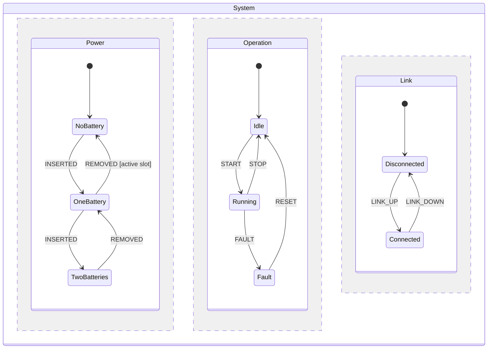
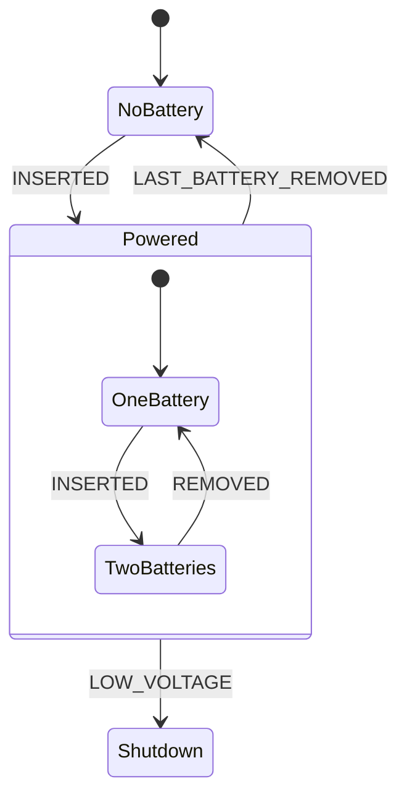
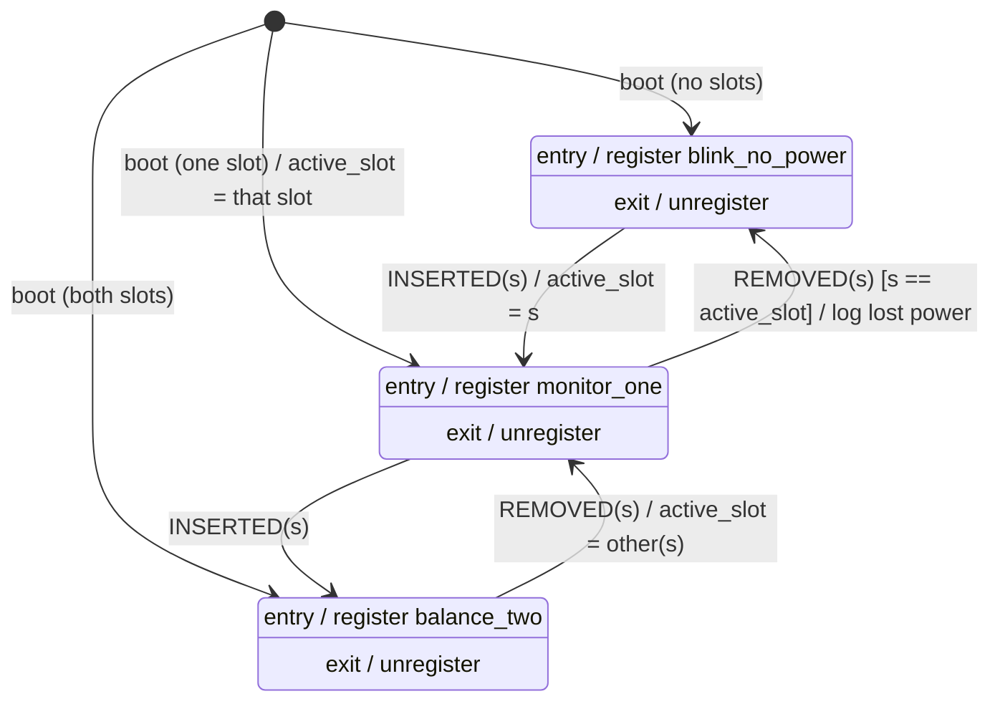

# Lecture 001 — Thinking in States: Seeing a System as Modes, Events, and Rules

> **For:** Timothy · **Date:** 2026-10-12
> **Prerequisites:** none. If you've read `lectures/leetcode/012` (design problems), §1 there is the same move this lecture makes: name the operations and the rules before choosing any mechanism.
> **Why this lecture:** a senior engineer told you that you get bogged down in implementation details, and suggested modeling the system as states. You tried, found that "everything is a state" explodes, started separating **inputs**, **states**, and **conditions**, designed **edges** that unregister and re-register routines, and built a **configuration structure** that routines branch on, which "doesn't exactly feel right." This lecture gives you several ways to see the same system, then checks your design against them. Most of your instincts are already the standard answers. The configuration structure is the one place where your unease is correct, and §7 shows why and what to do instead.

---

## Core ideas (the answer key)

1. **A state is the minimum the system must remember about the past to know how to react to the next event.** Two histories that would get the same reaction to every future event are the same state.
2. **The state test:** if the *same event* gets a *different response* depending on something, that something is state. If it doesn't change any response, it isn't state.
3. **Three kinds of things, three homes:** *events* (things that happen, at an instant) trigger transitions; *conditions* (facts you check at that instant) are guards that choose between transitions; *state* (what you remember) is where you are.
4. **Not every variable deserves to be a state.** Split memory into *control state* (the few named modes that change behavior) and *extended state* (numbers and parameters, like `active_slot`, carried alongside). The diagram shows only control state.
5. **A transition runs in a fixed order: exit the old state → run the edge's own action → enter the new state.** Your "unregister, act, register, set state" edge is exactly this order. Make each *state* own its routines (register on entry, unregister on exit), so the edge only carries what is unique to it.
6. **Branching on a mode inside a routine means there is a hidden state.** The fix is to move the decision to the edge (a guard) so that, inside a state, behavior is unconditional.
7. **Configuration that is fixed at boot is not state.** Read it once and use it to *choose* things (which parameter values, which routine set, which machine), instead of asking about it on every tick.
8. **When states multiply, it's usually because independent concerns were multiplied together.** Use *orthogonal regions* (independent machines side by side) and *hierarchy* (a parent state holding shared behavior) instead of listing every combination.
9. **Convert levels into events at the boundary.** A small "sense" layer turns raw pin levels and readings into a few clean events; the state machine only sees those events. Sense → decide → act.
10. **The transition table is the tool that makes you complete.** Every (state, event) cell must say: go somewhere, ignore, or "impossible." Empty cells are bugs you haven't met yet.
11. **The diagram is the high-level view your senior asked for.** Registering ISRs, timers, and queues are one rung below it. Draw the diagram first and keep it true; implement under it.

---

## Table of Contents

0. [Direct answers to your questions](#0-direct-answers-to-your-questions)
1. [Why states are the high-level view](#1-why-states-are-the-high-level-view)
2. [Lens 1 — State as memory of the past](#2-lens-1--state-as-memory-of-the-past)
3. [Lens 2 — State as a mode: the set of rules currently in force](#3-lens-2--state-as-a-mode-the-set-of-rules-currently-in-force)
4. [Lens 3 — Events, conditions, state: three kinds of things](#4-lens-3--events-conditions-state-three-kinds-of-things)
5. [Lens 4 — The transition table](#5-lens-4--the-transition-table)
6. [Lens 5 — Where behavior lives: entry, exit, edge, in-state](#6-lens-5--where-behavior-lives-entry-exit-edge-in-state)
7. [Your configuration structure: what it really is and four better homes](#7-your-configuration-structure-what-it-really-is-and-four-better-homes)
8. [Lens 6 — Taming the explosion: orthogonal regions and hierarchy](#8-lens-6--taming-the-explosion-orthogonal-regions-and-hierarchy)
9. [Lens 7 — Sense → decide → act](#9-lens-7--sense--decide--act)
10. [Lens 8 — Each state is a promise (invariants)](#10-lens-8--each-state-is-a-promise-invariants)
11. [The modeling procedure, step by step](#11-the-modeling-procedure-step-by-step)
12. [Worked example: a two-slot battery device, end to end](#12-worked-example-a-two-slot-battery-device-end-to-end)
13. [Your design, reviewed](#13-your-design-reviewed)
14. [Misconceptions and common mistakes](#14-misconceptions-and-common-mistakes)
15. [Interview relevance](#15-interview-relevance)
16. [Self-check questions](#16-self-check-questions)
17. [Sources](#17-sources)

---

## 0. Direct answers to your questions

1. **"Is it right to separate inputs, states, and conditions?"** Yes. That separation is the core of the whole method. The precise names are *events* (things that happen), *guards* (conditions checked when an event arrives), and *states* (what the system remembers). There is a fourth category you'll want: *extended state*, which is data the system remembers that doesn't deserve its own named state (§4).

2. **"Is my edge design right (unregister all → do the edge's action → register the new state's routines → set the state)?"** Yes, that is the standard execution order for a transition: *exit actions, then transition action, then entry actions.* One refinement: attach "register my routines" to each **state's entry** and "unregister my routines" to each **state's exit**, instead of writing it inside every edge. Then each edge only says what's unique to it, and you can't forget the bookkeeping on a new edge (§6).

3. **"Is it right to associate routines with states?"** Yes. A state is a *mode*, and a mode is defined by which rules and activities are active in it. "This state has these routines" is a clean description of a mode (§3).

4. **"The configuration structure that routines branch on doesn't feel right. Why?"** Because a routine that asks "which situation am I in?" is doing the state machine's job. Every branch in a routine that depends on the system's situation is a state you haven't named. The fix depends on what kind of thing each setting is: fixed at boot (choose once), a parameter (pass the value, no branching), or a real mode (promote it to a state or region, and decide it at the edge with a guard). §7 walks through all four homes.

5. **"There are so many input combinations (battery 1 in, battery 2 out, pin high…). How do I avoid modeling them all?"** Don't take the product of all inputs. Ask which combinations actually *change behavior* (§2), collapse the ones that don't (often into a parameter, like *which* slot), and split independent concerns into separate regions that run side by side (§8).

---

## 1. Why states are the high-level view

Your senior's advice is about **altitude**. A system can be described at several heights:

| Rung | Question it answers | Example from your system |
|---|---|---|
| 1. Purpose | What is this for? | Keep the device powered and safe from whichever batteries are present |
| 2. **Behavior model** | **What modes can it be in, and what moves it between them?** | **No battery / one battery / two batteries; insert and remove events** |
| 3. Contracts | What does each mode promise? | "In *Two batteries*, load is balanced and both are monitored" |
| 4. Control flow | Who calls what, in what order? | Timer fires → routine runs; pin change → event posted |
| 5. Implementation | How exactly? | `register_isr(&balance, 100)`; a ring buffer of events |
| 6. Runtime | What does the hardware actually do? | Timer peripheral, interrupt priorities |

A state diagram lives at rungs 2 and 3. Your natural search direction starts at rung 5 ("how do I register and unregister the routines?") and works upward. The state model forces you to answer rung 2 first, and rung 2 is what everything else depends on. If the modes are wrong, perfect ISR bookkeeping just runs the wrong behavior reliably.

**The practical rule:** draw the diagram and fill the table *before* writing any register/unregister code. If a question comes up that the diagram can't answer ("what happens if battery 2 is removed while I'm in X?"), that's a hole in the model, and it's much cheaper to fix there.

---

## 2. Lens 1 — State as memory of the past

### 2.1 The definition

Strip a system down: events come in over time, and the system responds. At any moment, the system has seen some **history** of events. It can't store the entire history forever, so it stores a summary. **The state is that summary.**

How much summary is needed? Exactly enough to respond correctly to whatever comes next. That gives the precise definition:

> **Two histories belong to the same state if and only if, for every possible future sequence of events, the system would respond identically after either one.**

This is the definition from automata theory (it's the idea behind minimizing a state machine), and it's the one that answers your "is this a state?" question.

### 2.2 The state test you'll actually use

The definition compresses into one question you can ask about any candidate:

> **Does the same event get a different response depending on this?**

- *Battery 2 is removed.* If one battery remains, the device keeps running from it. If no battery remains, it shuts down. Same event, different response → **the number of batteries present is state.**
- *A 100 ms timer fires.* With two batteries, the routine balances the load; with one, it monitors that one. Same event, different response → state again (the same state, in fact).
- *Battery 1's exact voltage is 3.71 V vs 3.72 V.* Does any event get a different response? Only if it crosses a threshold. The exact value is not a state; **crossing the threshold is an event** (§9).
- *Whether battery 1 or battery 2 is the single remaining one.* Does the response differ in *shape*, or only in *which slot it's applied to*? If the device does the same thing, just aimed at a different slot, that's a **parameter** (`active_slot`), not a separate state (§4.3).

### 2.3 Why this kills the explosion

Your first attempt modeled every input combination as a state. The definition says you only need as many states as there are *different futures*. Many input combinations lead to the same future behavior, so they collapse into one state. Start from behavior, not from inputs.

---

## 3. Lens 2 — State as a mode: the set of rules currently in force

The first lens says what a state *is*. This one says what it *feels like* from inside the system:

> **A state is a mode: a period of time during which a fixed set of rules applies.**

"Rules" here means two things:

1. **Which activities are running.** In your design, these are the periodic routines. *In "Two batteries," `balance_two` runs every 100 ms.*
2. **How each event is answered.** *In "Two batteries," a removal goes to "One battery." In "One battery," removing the active slot goes to "No battery."*

This is why your instinct to attach routines to states is correct. You were describing each mode by its active activities. When you're inside a state, nothing needs to be asked: the rules are the rules of that state. The rules only change at a transition.

A useful consequence: **"inside a state, behavior is unconditional."** If you find yourself writing `if (situation == X)` inside a routine that belongs to a state, the state didn't fully define the mode. Hold that thought; it's the key to §7.

---

## 4. Lens 3 — Events, conditions, state: three kinds of things

Here is the separation you were converging on, with precise definitions.

### 4.1 The four categories

| Category | What it is | Time shape | Where it lives in the model | Your examples |
|---|---|---|---|---|
| **Event** | Something that *happens* | An instant | The label on an edge (the trigger) | Battery inserted, battery removed, timer fired, button pressed |
| **Condition (guard)** | A fact that is true or false *right now* | A level, checked at an instant | In square brackets on an edge: `[slot == active_slot]` | Is the config pin high? Is the other slot occupied? |
| **Control state** | A named mode the system is in | A duration | A box on the diagram | No battery, One battery, Two batteries |
| **Extended state** | Remembered data that doesn't deserve its own box | A duration | A variable next to the machine | `active_slot`, a retry counter, the last error code |

**Configuration** looks like a fifth category but isn't one; it's a condition or a parameter that happens never to change after boot. §7 handles it.

### 4.2 Event vs condition: the confusion to avoid

"Battery 1 is plugged in" is a **condition** (a level). "Battery 1 was just plugged in" is an **event** (an edge). Your state machine should be *driven by events* and *consult conditions*. If you drive it by conditions ("every tick, if battery 1 is plugged in, go to state X"), you get two problems:

- The transition fires again on every tick while the condition holds, unless you add more checks.
- You lose the moment of change, which is where the action belongs ("log that the battery was just inserted").

The fix is to detect the change once, at the boundary, and emit an event (§9).

### 4.3 Control state vs extended state: the parameter test

How do you decide whether something is a box or a variable?

- If it changes **which rules apply**, it's control state (a box).
- If the rules are the same and it only changes **what they're applied to or with**, it's extended state (a variable).

"Battery 1 only" vs "battery 2 only": if the device runs the same monitoring, just on a different slot, make one state **One battery** with `active_slot ∈ {1, 2}`. If the slots are physically different (say, slot 2 can't supply full power, so the device must throttle), then they really are different modes and deserve separate boxes. **The physics decides, not the wiring.** That's a question to answer about your system, not one the method answers for you.

The cost of extended state: each variable widens what "being in this state" means. Keep the list short and write down what each variable means in each state (`active_slot` is meaningful only in *One battery*).

---

## 5. Lens 4 — The transition table

A diagram is good for seeing. A **table** is good for being complete. Rows are states, columns are events, and each cell says what happens.

| State ↓ / Event → | `INSERTED(slot)` | `REMOVED(slot)` |
|---|---|---|
| **No battery** | → One battery; `active_slot = slot` | *impossible* (nothing to remove) → ignore |
| **One battery** | → Two batteries | `[slot == active_slot]` → No battery; log<br>`[else]` *impossible* → ignore |
| **Two batteries** | *impossible* (both slots full) → ignore | → One battery; `active_slot = the other slot` |

Every cell must hold one of three answers:

1. **Go somewhere** (with an optional guard and action).
2. **Deliberately ignore** (the event is meaningful but changes nothing in this state).
3. **Impossible** (it can't happen if the rest of the system is correct). Decide what to do anyway: ignore, log, or assert. A glitchy pin *will* eventually deliver an "impossible" event.

**Why this matters for you specifically:** the table is the same move as writing the valid set before the condition (the `0 <= position <= n` habit from LeetCode). You enumerate the whole space first, then fill each cell positively. Missing cells are where the real bugs hide: "what happens if a removal arrives while we're in No battery?" is a question nobody asks until a contact bounces in the field.

**Table size check:** states × events. If that number feels unmanageable, it's the signal to split into regions (§8), not to skip cells.

---

## 6. Lens 5 — Where behavior lives: entry, exit, edge, in-state

Any piece of behavior in a state machine belongs in exactly one of four places:

| Place | Runs when | Use it for | Your system |
|---|---|---|---|
| **Entry action** | Every time the state is entered, by any edge | Setting up what the state needs | Register this state's routines |
| **Exit action** | Every time the state is left, by any edge | Tearing down what the state set up | Unregister this state's routines |
| **Transition action** (the edge's effect) | Only on this specific edge | What is unique to *this* change | Record `active_slot`; log "lost last battery" |
| **Do-activity / in-state** | Continuously while in the state | The ongoing work of the mode | The periodic routines themselves |

### 6.1 The execution order of a transition

When an event fires an edge from S to T:

```
1. exit(S)                 ← S tears down what S set up
2. transition action       ← the edge's own work
3. current = T
4. entry(T)                ← T sets up what T needs
```

This is the order UML state machines define, and it's what your edge design already does. The reasoning behind the order: the edge's action runs when the old mode's rules have stopped and the new mode's rules haven't started, so it never collides with either.

### 6.2 The refinement: let states own their routines

Your current design puts "unregister all" and "register the new state's routines" inside each edge. That works, but:

- Every new edge must remember to do the bookkeeping. One forgotten edge and a routine leaks into the wrong state.
- The edge has to know the *target* state's routine list, which is the state's business.

Move the bookkeeping into entry/exit, and write **one** `transition()` function that runs the order above. Then an edge is just *(source, event, guard) → (target, action)*, and the bookkeeping can't be forgotten because no edge does it. The worked example (§12) has this exact function.

**"Unregister all" vs "unregister this state's routines":** these are the same if your invariant holds (only the current state's routines are registered). "Unregister all" is a reasonable defensive choice. Just be aware it hides a broken invariant rather than revealing it. In development, it can help to assert that the registered set equals the current state's list.

### 6.3 Run-to-completion and where events come from

Two rules keep a state machine sane in a system with interrupts:

1. **Run-to-completion:** the machine finishes handling one event (including exit, action, entry) before it looks at the next one. Never start a transition in the middle of another.
2. **Interrupts post events; they don't make transitions.** A pin-change interrupt or a timer routine that detects something should put an event into a queue. The main loop takes events off the queue and calls `dispatch()`. Then only one place in the program ever changes the state, and transitions can't interleave.

Your periodic routines are the system's *activities*. They may detect things ("voltage crossed the low threshold") and post events, but they shouldn't call `transition()` themselves.

---

## 7. Your configuration structure: what it really is and four better homes

### 7.1 What you built

You have a structure holding observed settings (battery 1 present, battery 2 present, config pin level). Routines read it and branch:

```c
void monitor(void) {
    if (cfg.b1_present && cfg.b2_present) { /* balance */ }
    else if (cfg.b1_present)              { /* watch slot 1 */ }
    else if (cfg.b2_present)              { /* watch slot 2 */ }
    else                                  { /* blink no-power LED */ }
    if (cfg.pin_high) { /* ... */ }
}
```

### 7.2 Why it feels wrong

Apply the test from §3. Inside a state, behavior should be unconditional. This routine asks "which situation am I in?" every time it runs. Each branch is a mode. **You built a second, hidden state machine inside the routine,** with no diagram, no table, no entry/exit, and no single place where the mode changes. The two machines (the explicit one with your edges, and the implicit one in the branches) can disagree, and nothing will tell you.

Concretely, this causes:

- **No moment of change.** The routine notices "now there's one battery" on its next tick, but nobody ran the action for *losing* a battery.
- **Duplicated decisions.** Every routine that cares re-derives the mode from raw flags, and each may derive it slightly differently.
- **Untestable combinations.** You can't list the modes, so you can't check them.

### 7.3 Sort each setting into its real category

Not every setting is the same kind of thing. Ask two questions about each one:

1. **Can it change while the system runs?**
2. **Does it change *which rules apply*, or only *a value the rules use*?**

| Fixed at boot? | Changes the rules? | What it is | Home |
|---|---|---|---|
| Yes | No (just a value) | **Parameter** | Read once into a constant (a threshold, a period). Routines use the value; nobody branches on it. |
| Yes | Yes | **Variant** (a different build of the behavior) | Choose *once at boot* which routine set, table, or machine to use. After boot, nothing asks again. |
| No | No | **Extended state** | A variable next to the machine, set by transition actions (`active_slot`). |
| No | Yes | **Mode** | A state (or a region, §8). Decide it at the edge with a guard. Routines inside it don't ask. |

### 7.4 The four homes, in your system's terms

**Home 1: Parameter.** Say the config pin selects a low-voltage threshold (3.3 V vs 3.5 V). Read the pin at boot, store `profile->low_voltage_mv`, and the monitoring routine uses the number. No `if`. This is "data, not branches."

**Home 2: Variant chosen at boot.** Say the pin selects between two products that behave differently (one supports two slots, one supports only one). Read it at boot and pick *which machine to run* (or which table, or which routine sets). This is the strategy idea: decide once, then the chosen behavior runs without asking. The rest of the program never sees the pin again.

**Home 3: Extended state.** "Which slot is the active one" changes at runtime but doesn't change the rules' shape. It's set by an edge's action (`active_slot = slot`) and read by the routines of the one state where it's meaningful.

**Home 4: Mode (state), decided by a guard.** Battery presence changes at runtime *and* changes the rules. So it becomes the states No / One / Two. The decision ("does this removal leave one battery or none?") happens **once, at the edge**, with a guard: `REMOVED(slot) [slot == active_slot] → No battery`. After that, the routines in each state just do their job.

### 7.5 The before/after in one picture

| | Your current design | Refined design |
|---|---|---|
| Where the mode is decided | Inside every routine, every tick | Once, on the edge, when the event arrives |
| What a routine asks | "Which situation am I in?" | Nothing; it only runs in its own state |
| Config pin | Read by routines at runtime | Read once at boot → a parameter or a variant |
| Battery presence | Flags in a struct | Events (inserted/removed) + states + `active_slot` |
| How you'd find all modes | Read every routine's branches | Look at the diagram |

**One honest caveat.** A small amount of reading data inside a routine is fine; a routine that uses `active_slot` or a threshold is using a parameter, not branching on a mode. The smell is specifically **branching on the system's situation**. The test: if the branch condition would be different in a different state of the diagram, the branch belongs on an edge.

---

## 8. Lens 6 — Taming the explosion: orthogonal regions and hierarchy

When you tried to model everything as states, the count exploded. That's a well-known problem (**state explosion**), and David Harel's statecharts (1987) were invented largely to solve it, with two tools.

### 8.1 Why it explodes: you multiplied independent things

Suppose the system has three concerns:

- Power: No / One / Two batteries (3 states)
- Operation: Idle / Running / Fault (3 states)
- Link: Disconnected / Connected (2 states)

If you draw one flat machine, every box is a combination: 3 × 3 × 2 = **18 states**, and every event needs an edge out of each of them. Add one more concern and it multiplies again.

But these concerns are mostly **independent**: whether the link is up doesn't change how batteries are handled. Multiplying independent things is what causes the explosion.

### 8.2 Tool 1: orthogonal regions (side by side)

Run the concerns as **separate machines in parallel**. The system is in one state of *each* region at once.



Count now: 3 + 3 + 2 = **8 states**, with 3 small tables instead of one huge one. Addition, not multiplication.

When regions do interact, they do it in two controlled ways:

- **A guard reads another region's state:** `START [Power is not NoBattery] → Running`.
- **An action in one region posts an event to another:** entering *NoBattery* posts `FAULT` to the Operation region.

Each interaction is written down on one edge, so you can find them all.

### 8.3 Tool 2: hierarchy (nesting)

Sometimes several states share behavior. Say *One battery* and *Two batteries* both respond to a "low voltage" event the same way, and both run a status-report routine. Put them inside a parent state **Powered**:



Rules for nesting:

- An event the child doesn't handle **falls through to the parent**. `LOW_VOLTAGE` is written once, on *Powered*, and applies in both children.
- Entering a child also means being in the parent: the parent's entry runs first (register `report_status`), then the child's (register `balance_two`). Exiting runs in reverse: child's exit, then the parent's.
- The shared routine is registered once, by the parent, and stays registered while you move between children. Your "unregister all" approach would tear it down and re-register it on every child-to-child move; the hierarchical version doesn't touch it.

### 8.4 When to use which

| Situation | Tool |
|---|---|
| Two concerns change independently (power and link) | **Orthogonal regions** |
| Several states share responses or activities | **Hierarchy** |
| A combination of inputs only matters for one decision | **A guard** on that one edge (no new state) |
| States differ only in which thing they act on | **Extended state** (a parameter) |

Your battery-and-pin combinations are a mix: battery presence is one region; the pin is configuration (§7), not a region at all.

---

## 9. Lens 7 — Sense → decide → act

A clean way to see the whole system is as three layers with one job each:

```
  raw world                      SENSE                    DECIDE                    ACT
  ─────────                      ─────                    ──────                    ───
  pin levels      ──►  debounce, compare to last,  ──►  state machine:     ──►  entry/exit/edge
  ADC readings         detect crossings, classify       (state, event)          actions; routines
  timers                → clean EVENTS                  → transition            registered per state
```

- **Sense** turns messy levels into a small vocabulary of events. "Slot 2 presence went 1 → 0 and stayed there for 50 ms" becomes `REMOVED(2)`. "Battery voltage dropped below the threshold" becomes `LOW_VOLTAGE`. This layer is where *raw inputs* belong, and it's the only layer that knows about pins.
- **Decide** is the state machine. It knows nothing about pins, ADCs, or debounce. It sees events, checks guards, and changes state.
- **Act** is entry/exit/transition actions and the routines each state runs.

This layering answers the "so many inputs" worry directly. The number of *raw input combinations* is large, but the number of *events* the sense layer produces is small, and the state machine only deals with events. If adding a new sensor only adds one or two events, the model stays small.

It also makes testing easy: you can drive the decide layer with a scripted list of events (which is exactly what the worked example's `main()` does) without any hardware.

---

## 10. Lens 8 — Each state is a promise (invariants)

The last lens is the most useful one for reviewing a design. For each state, write one sentence that is **always true while the system is in it**:

| State | Invariant (what is promised) |
|---|---|
| No battery | No slot is occupied; only `blink_no_power` is registered; `active_slot` is meaningless. |
| One battery | Exactly one slot is occupied, and it is `active_slot`; only `monitor_one` is registered. |
| Two batteries | Both slots are occupied; only `balance_two` is registered. |

Then check every edge against it: **after entry(T) runs, does T's promise hold?** For example, `TWO → ONE` on `REMOVED(2)` must set `active_slot = 1`, or the *One battery* promise is broken. That's how you find a missing transition action.

This is the same skill as naming a valid set before writing a guard: you state, positively, what "correct" looks like in each state, then verify that every way in establishes it. It's also what makes a design discussion with your senior short: "here are the states, here's what each one promises, here are the edges."

---

## 11. The modeling procedure, step by step

Use this sequence on any system. Each step is one decision.

1. **Write the purpose in one sentence.** "The device runs from whichever batteries are present and shuts down safely when none are."
2. **List the events** (things that happen, not levels). Inserted(slot), Removed(slot), Low voltage, Timer, Start, Stop…
3. **List the configuration** and sort each item with the §7.3 table (parameter or variant). Take it out of the runtime model.
4. **Propose candidate modes** by asking: "What are the different ways this system behaves over time?"
5. **Test each candidate** with the state test (§2.2): same event, different response? If not, merge it with another state or make it extended state.
6. **Group independent concerns into regions** (§8.2). Each region gets its own small set of states.
7. **Fill the transition table for each region** (§5). Every cell: go / ignore / impossible. Guards decide between cells' outcomes; actions do the edge's unique work.
8. **Assign behavior to its place** (§6): entry/exit for setup and teardown (routine registration), edge actions for one-off work, routines for ongoing work.
9. **Write each state's invariant** (§10) and check every edge into it.
10. **Check routines for mode branches.** Any `if` on the system's situation → move it to a guard or a state (§7).
11. **Trace scenarios** through the table: "boot with only slot 2 → insert 1 → remove 2 → remove 1." Write the expected states and registered routines at each step, then run it.

Only after step 11 do you write the scheduler, the ISR registration, and the event queue. Those are rung 5, and they now have an exact specification.

---

## 12. Worked example: a two-slot battery device, end to end

A generic device: two battery slots, a configuration pin read at boot, and timer-driven routines.

### 12.1 Steps 1–5

1. **Purpose:** run from whatever batteries are present; indicate when there are none.
2. **Events:** `INSERTED(slot)`, `REMOVED(slot)` (produced by the sense layer from debounced presence pins).
3. **Configuration:** the config pin selects a low-voltage threshold → **parameter** (Home 1). Read at boot into `profile`.
4. **Candidate modes:** b1-only, b2-only, both, neither.
5. **State test:** b1-only vs b2-only respond identically except for which slot they act on → merge into **One battery** with extended state `active_slot`. Result: **No battery, One battery, Two batteries.**

### 12.2 The diagram



Read an edge label as **`EVENT [guard] / action`**. The table in §5 is the same model, written for completeness rather than for looking at.

### 12.3 The code

The whole thing in C. The scheduler and routines are simulated with `printf`, so it runs on any machine. Notice what *isn't* here: no routine branches on battery presence or on the config pin.

```c
/* power_sm.c - a small state machine with entry/exit-owned routines.
 * Build and run:  cc -std=c11 -Wall -Wextra -o power_sm power_sm.c && ./power_sm
 * Everything hardware-specific is simulated with printf.
 */
#include <stdio.h>
#include <stdbool.h>

/* ---------- 1. Vocabulary: states, events, routines ---------- */

typedef enum { ST_NO_BATTERY, ST_ONE_BATTERY, ST_TWO_BATTERIES } state_t;
typedef enum { EV_BAT_INSERTED, EV_BAT_REMOVED } event_kind_t;
typedef struct { event_kind_t kind; int slot; } event_t;   /* slot = 1 or 2 */

typedef void (*routine_fn)(void);
typedef struct { const char *name; routine_fn fn; unsigned period_ms; } routine_t;

/* ---------- 2. Static configuration: read once at boot, never branched on later ---------- */

typedef struct { const char *name; unsigned low_voltage_mv; } profile_t;
static const profile_t PROFILE_A = { "A", 3300 };
static const profile_t PROFILE_B = { "B", 3500 };
static const profile_t *profile;              /* chosen in boot(); data, not a mode */

/* ---------- 3. Extended state: data that varies but does not change behavior shape ---------- */

static state_t current;
static int active_slot;                       /* meaningful only in ST_ONE_BATTERY */

/* ---------- 4. Routines (would be timer-driven ISRs on the real system) ---------- */

static void blink_no_power(void) { printf("    [routine] blink 'no battery' LED\n"); }
static void monitor_one(void)    { printf("    [routine] monitor slot %d, low=%umV\n", active_slot, profile->low_voltage_mv); }
static void balance_two(void)    { printf("    [routine] balance load across slots 1 and 2\n"); }

static const routine_t ROUTINES_NO[]  = { { "blink_no_power", blink_no_power, 500 } };
static const routine_t ROUTINES_ONE[] = { { "monitor_one",    monitor_one,    100 } };
static const routine_t ROUTINES_TWO[] = { { "balance_two",    balance_two,    100 } };

/* Simulated scheduler: register / unregister / tick */
#define MAX_REG 8
static const routine_t *registered[MAX_REG];
static int n_registered;

static void register_routines(const routine_t *r, int n) {
    for (int i = 0; i < n; i++) {
        registered[n_registered++] = &r[i];
        printf("    register   %s (%ums)\n", r[i].name, r[i].period_ms);
    }
}
static void unregister_all(void) {
    for (int i = 0; i < n_registered; i++) printf("    unregister %s\n", registered[i]->name);
    n_registered = 0;
}
static void tick(void) { for (int i = 0; i < n_registered; i++) registered[i]->fn(); }

/* ---------- 5. Entry / exit: the state owns its routines ---------- */

static const char *NAMES[] = { "NO_BATTERY", "ONE_BATTERY", "TWO_BATTERIES" };

static void on_entry(state_t s) {
    switch (s) {
    case ST_NO_BATTERY:    register_routines(ROUTINES_NO,  1); break;
    case ST_ONE_BATTERY:   register_routines(ROUTINES_ONE, 1); break;
    case ST_TWO_BATTERIES: register_routines(ROUTINES_TWO, 1); break;
    }
}
static void on_exit(state_t s) { (void)s; unregister_all(); }

/* exit(source) -> transition action -> entry(target).  The ONLY place 'current' changes. */
static void transition(state_t target, void (*action)(int), int arg) {
    printf("  %s -> %s\n", NAMES[current], NAMES[target]);
    on_exit(current);
    if (action) action(arg);
    current = target;
    on_entry(current);
}

/* Transition actions (belong to the edge, not to either state) */
static void set_active(int slot)   { active_slot = slot; printf("    action: active_slot = %d\n", slot); }
static void log_lost_power(int s)  { printf("    action: log 'lost last battery (slot %d)'\n", s); }

/* ---------- 6. The transition table, written as code: (state, event, guard) -> target ---------- */

static void dispatch(event_t e) {
    printf("event %s slot %d in %s\n",
           e.kind == EV_BAT_INSERTED ? "INSERTED" : "REMOVED", e.slot, NAMES[current]);
    switch (current) {
    case ST_NO_BATTERY:
        if (e.kind == EV_BAT_INSERTED) transition(ST_ONE_BATTERY, set_active, e.slot);
        break;                                                   /* REMOVED: impossible, ignore */
    case ST_ONE_BATTERY:
        if (e.kind == EV_BAT_INSERTED)                           transition(ST_TWO_BATTERIES, NULL, 0);
        else if (e.kind == EV_BAT_REMOVED && e.slot == active_slot) transition(ST_NO_BATTERY, log_lost_power, e.slot);
        break;                                                   /* REMOVED other slot: impossible, ignore */
    case ST_TWO_BATTERIES:
        if (e.kind == EV_BAT_REMOVED) transition(ST_ONE_BATTERY, set_active, 3 - e.slot); /* the slot that remains */
        break;                                                   /* INSERTED: impossible, ignore */
    }
}

/* ---------- 7. Boot: read config once, classify initial inputs, enter the first state ---------- */

static void boot(bool config_pin_high, bool b1, bool b2) {
    profile = config_pin_high ? &PROFILE_B : &PROFILE_A;
    printf("boot: profile %s, b1=%d b2=%d\n", profile->name, b1, b2);
    if (b1 && b2)      current = ST_TWO_BATTERIES;
    else if (b1 || b2) { current = ST_ONE_BATTERY; active_slot = b1 ? 1 : 2; }
    else               current = ST_NO_BATTERY;
    printf("  initial state %s\n", NAMES[current]);
    on_entry(current);
}

int main(void) {
    boot(true, false, false);
    tick();
    dispatch((event_t){ EV_BAT_INSERTED, 2 });  tick();
    dispatch((event_t){ EV_BAT_INSERTED, 1 });  tick();
    dispatch((event_t){ EV_BAT_REMOVED,  2 });  tick();
    dispatch((event_t){ EV_BAT_REMOVED,  1 });  tick();
    return 0;
}
```

**Before running it, predict:** after `REMOVED 2` in *Two batteries*, which state are you in, what is `active_slot`, and which routine is registered? (Answer in the output below.)

### 12.4 Real output (compiled with `cc -std=c11 -Wall -Wextra`, no warnings; run 2026-10-12)

```
boot: profile B, b1=0 b2=0
  initial state NO_BATTERY
    register   blink_no_power (500ms)
    [routine] blink 'no battery' LED
event INSERTED slot 2 in NO_BATTERY
  NO_BATTERY -> ONE_BATTERY
    unregister blink_no_power
    action: active_slot = 2
    register   monitor_one (100ms)
    [routine] monitor slot 2, low=3500mV
event INSERTED slot 1 in ONE_BATTERY
  ONE_BATTERY -> TWO_BATTERIES
    unregister monitor_one
    register   balance_two (100ms)
    [routine] balance load across slots 1 and 2
event REMOVED slot 2 in TWO_BATTERIES
  TWO_BATTERIES -> ONE_BATTERY
    unregister balance_two
    action: active_slot = 1
    register   monitor_one (100ms)
    [routine] monitor slot 1, low=3500mV
event REMOVED slot 1 in ONE_BATTERY
  ONE_BATTERY -> NO_BATTERY
    unregister monitor_one
    action: log 'lost last battery (slot 1)'
    register   blink_no_power (500ms)
    [routine] blink 'no battery' LED
```

Every transition prints in the same order: **unregister (exit) → action (edge) → register (entry).** That's your edge design, with the bookkeeping moved to the states.

### 12.5 What to notice

- **`dispatch()` is the transition table.** Each `case` is a row; each `if` is a cell with its guard. The comments mark the "impossible" cells explicitly.
- **`transition()` is the only place `current` changes.** If you add an event queue, the main loop is just `while (pop(&e)) dispatch(e);`, and interrupts only `push()`.
- **The config pin appears in exactly one line** (`boot`). `monitor_one` uses `profile->low_voltage_mv` as a value and never asks about the pin.
- **`active_slot` is extended state**, set only by edge actions and read only by the routine of the one state where it's meaningful.
- **Boot is a transition too.** The initial state is chosen by classifying the inputs once (the three `[*]` arrows in the diagram). After that, only events move the machine.

### 12.6 Exercises on this example (no answers, by design)

1. Add `LOW_VOLTAGE`. Where does it go in the table? Is it cleaner with a *Powered* parent state (§8.3)? Sketch both.
2. Suppose slot 2 can't supply full power, so with only slot 2 the device must throttle. Does *One battery* split into two states? Redo the state test.
3. Add an Operation region (Idle / Running). Which edges need a guard that reads the Power region?

---

## 13. Your design, reviewed

| Your idea | Verdict | Precise name | Refinement |
|---|---|---|---|
| Separate inputs, states, conditions | ✅ Correct, and the core of the method | Events / control state / guards (+ extended state) | Drive the machine by **events**; consult **conditions** only as guards (§4.2) |
| Edges move the system between states | ✅ | Transitions | Label each as `EVENT [guard] / action` |
| Edge = unregister all → action → register → set state | ✅ The standard order | exit → transition effect → entry | Put register/unregister in each state's entry/exit; one `transition()` function (§6.2) |
| A state has many routines | ✅ | Activities owned by a state (a mode) | With hierarchy, shared routines live in a parent state and survive child-to-child moves (§8.3) |
| Routines are interrupt-driven on a schedule | ✅ Fine as activities | Do-activities | Routines may *post* events; they never call `transition()` (§6.3) |
| Config structure; routines branch on it | ⚠️ Your unease is right | A hidden second state machine | Sort each setting: parameter / variant / extended state / mode (§7.3); decide modes on edges with guards |
| "Everything as a state" (first attempt) | ❌ Explodes | Product of all inputs | Only behavior-changing distinctions become states (§2); independent concerns become regions (§8) |

**Overall:** you independently arrived at the event/guard/state split and at the UML transition order. The remaining gap is one idea: **decisions about the mode belong on edges, so behavior inside a state can be unconditional.** Your config structure moved those decisions into the routines.

---

## 14. Misconceptions and common mistakes

| You might think… | Actually… | Why it matters |
|---|---|---|
| "More states = more precise model." | More states than *different behaviors* is just more places for bugs. | The minimal model is the one you can check. |
| "The state is all the variables." | That's the full system state. The *control* states are a partition of it into regions of identical behavior. | Diagrams only show control state; extended state rides alongside. |
| "Conditions can trigger transitions." | Changes in conditions should be turned into events at the boundary; conditions guard transitions. | Level-triggered transitions refire every tick and lose the moment of change. |
| "An ISR can just set `state = X`." | Then transitions can interleave, and exit/entry get skipped. Post an event; let one place transition. | Run-to-completion is what makes the model trustworthy. |
| "Every edge should clean up and set up." | That's the states' job (exit/entry). The edge does only what's unique to it. | One forgotten edge = a routine running in the wrong state. |
| "Impossible events don't need handling." | They need a *decision* (ignore, log, assert). Bounces and glitches make them possible. | Empty cells become undefined behavior in the field. |
| "Configuration flags are harmless to check anywhere." | A runtime check of fixed config is a mode decision repeated forever. Decide once at boot. | Removes a whole dimension from the runtime model. |
| "A state diagram is documentation for after the code." | It's the specification *before* the code. | That's the altitude your senior is asking for. |

---

## 15. Interview relevance

- **Low-level design questions** are often state machines in disguise: vending machine, elevator, traffic light, parking lot gate, order lifecycle (`Created → Paid → Shipped → Delivered`, with `Cancelled` reachable only from some states), connection lifecycles. The winning first move is the same as here: list states and events, draw the table, *then* write classes.
- **The State pattern** (Gang of Four) is the object-oriented version of this lecture: each state is a class implementing the same interface (`onInserted()`, `onRemoved()`), and the context object holds a reference to the current state. `switch` vs State pattern is a fine thing to discuss; for small machines a table or switch is clearer.
- **Real protocols are specified this way.** TCP's connection behavior is defined as a state machine (`LISTEN`, `SYN-SENT`, `ESTABLISHED`, `FIN-WAIT-1`…) in its RFC. Being able to say "I'd model this as a state machine; here are the states and what each one promises" signals exactly the high-level thinking interviewers look for.
- **A sentence to have ready:** *"I separate events, guards, and states; decisions about the mode happen on transitions, so behavior inside each state is unconditional, and I check completeness with a state-by-event table."*

---

## 16. Self-check questions

1. State the definition of a state in terms of histories and futures.
   <details><summary>Answer</summary>Two histories are the same state if, for every possible future sequence of events, the system would respond identically after either one. The state is the minimal summary of the past needed to respond correctly to the future.</details>

2. What one question tells you whether a distinction should be a state?
   <details><summary>Answer</summary>"Does the same event get a different response depending on this?" If yes, it's state. If no, it isn't (it may be a parameter, extended state, or irrelevant).</details>

3. "Battery 1 is plugged in" and "battery 1 was plugged in." Which is an event and which is a condition, and which should drive the machine?
   <details><summary>Answer</summary>"Was plugged in" is the event (an instant); "is plugged in" is a condition (a level). Events drive transitions; conditions are checked as guards when an event arrives. The sense layer converts the level change into the event.</details>

4. In what order do things run when an edge from S to T fires, and why that order?
   <details><summary>Answer</summary>exit(S) → the transition's action → current = T → entry(T). The edge's action runs after S's rules have stopped and before T's have started, so it never collides with either mode's activities.</details>

5. Why move "unregister/register routines" from the edges into entry/exit?
   <details><summary>Answer</summary>So no edge can forget it, and edges don't need to know other states' routine lists. Each state owns its setup and teardown; each edge carries only its unique work.</details>

6. A routine contains `if (cfg.b1_present && cfg.b2_present) {...} else {...}`. What does that tell you, and what's the fix?
   <details><summary>Answer</summary>There's a hidden state: the routine is deciding the mode itself. Make battery presence into states (driven by inserted/removed events) and decide the mode on edges with guards; each state then has a routine that doesn't branch.</details>

7. The config pin selects a threshold value. Where does it go? What if it selected an entirely different behavior set?
   <details><summary>Answer</summary>Threshold: a parameter read once at boot and used as a value (no branch). Different behavior set: a variant chosen once at boot (which machine/table/routine sets to run). Neither belongs in the runtime state model.</details>

8. Three independent concerns with 3, 3, and 2 states. How many states as one flat machine? As orthogonal regions?
   <details><summary>Answer</summary>Flat: 3 × 3 × 2 = 18. Regions: 3 + 3 + 2 = 8, in three small tables.</details>

9. What does a parent state buy you over "unregister all" on every transition?
   <details><summary>Answer</summary>Shared responses are written once on the parent, and shared routines are registered once on the parent's entry and stay registered while moving between children; only the child's own routines are swapped.</details>

10. Why shouldn't an interrupt routine call `transition()` directly?
    <details><summary>Answer</summary>It could interrupt a transition that's already running (breaking run-to-completion), interleave exits and entries, and scatter state changes across the program. Interrupts should post events; one loop dispatches them.</details>

11. In the example, why is `active_slot` extended state rather than two states?
    <details><summary>Answer</summary>Because, in this example, one battery in slot 1 and one in slot 2 behave identically except for which slot is acted on. If the slots behaved differently (e.g., one requires throttling), they would be separate states.</details>

12. What three answers can a transition-table cell have?
    <details><summary>Answer</summary>Go to a state (with an optional guard and action); deliberately ignore; or impossible, with an explicit decision about what to do if it happens anyway (ignore, log, assert).</details>

13. Write the invariant for *Two batteries*, and name an edge that would break *One battery*'s invariant if its action were missing.
    <details><summary>Answer</summary>"Both slots are occupied and only balance_two is registered." The edge TWO → ONE on REMOVED(s) must set active_slot to the remaining slot; without that action, One battery's promise ("the occupied slot is active_slot") can be false.</details>

---

## 17. Sources

Checked 2026-10-12.

- David Harel, "Statecharts: A Visual Formalism for Complex Systems," *Science of Computer Programming* 8 (1987). The origin of hierarchy and orthogonal regions as the cure for state explosion. Overview and copy: [University of Edinburgh course copy](https://www.inf.ed.ac.uk/teaching/courses/seoc/2006_2007/resources/statecharts.pdf); readable summary: [Recurse Center, Paper of the Week](https://www.recurse.com/blog/59-paper-of-the-week-statecharts-a-visual-formalism-for-complex-systems).
- OMG, *Precise Semantics of UML State Machines (PSSM)*, which formalizes exit → effect → entry ordering and run-to-completion: [OMG PSSM](https://issues.omg.org/issues/spec/PSSM). Survey of formal UML state-machine semantics: [arXiv 2407.17215](https://arxiv.org/pdf/2407.17215).
- Stately / XState documentation on **guards** and **context** (their name for extended state), a clear modern treatment of the same split: [Guards](https://stately.ai/docs/guards), [Context](https://xstate.js.org/docs/guides/context.html).
- Miro Samek, *Practical UML Statecharts in C/C++* (2nd ed.), and the QP framework: hierarchical state machines with event queues and run-to-completion on small embedded targets. [state-machine.com](https://www.state-machine.com/).
- TCP connection state machine: RFC 9293, §3.3.2. [rfc-editor.org/rfc/rfc9293](https://www.rfc-editor.org/rfc/rfc9293).
- The example program in §12 was compiled and run on 2026-10-12 (`cc -std=c11 -Wall -Wextra`, no warnings); the output shown is the real output.
