# Lecture 002 — The Return Is the Edge: State Functions, Continuations, and Building States from Elements

> **For:** Timothy · **Date:** 2026-10-12
> **Prerequisites:** `001-thinking_in_states.md` (states, events, guards, the exit → action → entry order, orthogonal regions and hierarchy). This lecture reuses its two-slot battery device.
> **Why this lecture:** after reading your state-machine design, your senior engineer suggested two next steps. First: **think of the return as the edge**, where each function returns the next function to run. He linked this to Guy Steele's argument that a call doesn't have to mean "push a return address and come back," because you can say explicitly where to go next. You noticed it feels like ASP.NET Core's `next`. Second: **investigate generalized state machines**, meaning software that builds *derived* states up from *elemental* ones. This lecture takes both, connects them, and runs every example.

---

## Core ideas (the answer key)

1. **A state can be a function, and its return value is the edge.** The function does the state's work, then returns the function for the next state. The graph's nodes are the functions; its edges are the `return` statements.
2. **A driver loop runs the graph:** `while state: state = state(ctx)`. The loop holds "where am I"; each state only says "where next". This loop is called a **trampoline**.
3. **Calling the next state instead of returning it grows the call stack by one frame per edge**, so a long-running machine eventually crashes. Returning it to the loop keeps the stack flat.
4. **Steele's point (1977): a call in tail position is a GOTO that passes arguments.** It needs no return address, so it doesn't have to grow the stack. "Returning to the caller" is one choice of where to go next, not a law. Languages that guarantee this (Scheme) can write state machines as functions calling functions. Languages that don't (Python, C#, Go; C only when the optimizer happens to do it) use the trampoline instead.
5. **"Where to go next" as a value has a general name: a continuation.** A return address is an implicit continuation. Passing the next step explicitly is *continuation-passing style*. Landin's J operator (1965) was an early way to grab one as a value.
6. **ASP.NET Core's `next` is the sibling of this idea, not the same thing.** A middleware *receives* `next` (the rest of the pipeline, wired once at startup) and *calls* it, then runs again on the way back. A state function *returns* its successor, chosen at run time, and never comes back.
7. **In an event-driven system, a state is a handler: `next = state(event)`.** The dispatcher compares old and new and runs exit and entry. This is how Samek's QP framework represents states in C.
8. **"Generalized state machine" isn't one standard term.** It usually means machines with variables and guards (extended FSMs), hierarchy and regions (statecharts), or composition from smaller machines. The software tools are statechart engines: SCXML, XState, Stateless (.NET), QP.
9. **Elemental states model one independent fact each** (slot 1 occupied? link up?). **Derived states are named predicates over elemental states** (`Powered = slot1 OR slot2`, `Reporting = Powered AND link up`). A statechart parent state is an OR of its children; orthogonal regions are an AND.
10. **Store the elements, compute the derivations.** A derived state stored separately will drift out of sync. Behavior attaches to derived states; their entry and exit come from the *difference* between the active sets before and after each event.
11. **Settle derived states once per event, not once per elemental change.** Otherwise the system passes through intermediate states that never really existed (a *glitch*). Also check that sibling derived states partition every elemental combination.

---

## Table of Contents

0. [Direct answers](#0-direct-answers)
1. [Three ways to store "where to go next"](#1-three-ways-to-store-where-to-go-next)
2. [State functions: the return is the edge](#2-state-functions-the-return-is-the-edge)
3. [The stack problem, and Steele's answer](#3-the-stack-problem-and-steeles-answer)
4. [Continuations: the general idea under all of this](#4-continuations-the-general-idea-under-all-of-this)
5. [ASP.NET Core `next`: same family, different shape](#5-aspnet-core-next-same-family-different-shape)
6. [Event-driven state functions: your device, rewritten](#6-event-driven-state-functions-your-device-rewritten)
7. [Generalized state machines: what the term can mean](#7-generalized-state-machines-what-the-term-can-mean)
8. [Elemental and derived states](#8-elemental-and-derived-states)
9. [A small engine: elemental machines in, derived behavior out](#9-a-small-engine-elemental-machines-in-derived-behavior-out)
10. [Choosing a representation](#10-choosing-a-representation)
11. [Misconceptions](#11-misconceptions)
12. [Interview relevance](#12-interview-relevance)
13. [Self-check questions](#13-self-check-questions)
14. [Sources](#14-sources)

---

## 0. Direct answers

1. **"Return a function that is the next function to call": is that a real technique?** Yes. It's called **state functions**. Rob Pike's Go lexer is the best-known modern example: `type stateFn func(*lexer) stateFn`, a function type whose return type is itself (§2).

2. **What was Steele saying?** In *Lambda: The Ultimate GOTO* (MIT AI Memo 443, 1977), he argued that a procedure call doesn't inherently cost a stack frame. When the call is the last thing a function does (a **tail call**), there's nothing to come back for, so it can be compiled as a **jump that carries arguments**. That makes functions as cheap and expressive as GOTO, and a set of functions that tail-call each other *is* a state machine (§3).

3. **Landin and *The Next 700 Programming Languages*.** One correction first: that paper didn't come up earlier in this conversation. It may have been your senior or another chat. It's still a good reference, so here's how it fits. The 1966 paper proposed ISWIM, a *family* of languages built from one small core of expressions plus domain-specific primitives. It's an early version of "build up from elements," which is your second topic. The part that connects to the return-as-edge idea is in Landin's other 1965 work, the **J operator**, which let a program hold "where control would go next" as a value. That idea later became **continuations** (§4).

4. **Is ASP.NET Core's `next` the same idea?** Same family, different shape. In both, the next step is a value you hold instead of something fixed by the call stack. But middleware **receives** `next` and **calls** it (and code after the call runs on the way back out). A state function **returns** its successor and is finished. Middleware forms a chain wired at startup; state functions form a graph chosen at run time (§5).

5. **Generalized state machines, elemental to derived.** Model each independent fact as a tiny elemental machine. Define derived states as named predicates over them (AND across facts, OR across alternatives). Attach behavior to the derived states, and compute their entries and exits automatically from what changed. Statechart hierarchy and regions turn out to be special cases of this (§7–9). Because the term isn't standard, ask your senior which tool or paper he has in mind. §7 gives you the vocabulary to ask precisely.

---

## 1. Three ways to store "where to go next"

Every state machine must remember where it is and decide where to go. There are three common ways to represent that in code:

| Representation | "Where am I" is… | "Where next" is decided by… | Example |
|---|---|---|---|
| **Enum + switch** | A variable `current = ST_ONE_BATTERY` | A `switch (current)` in the dispatcher | Lecture 001 §12 |
| **Table** | An index into a table | A lookup `table[current][event]` | Lecture 001 §5 |
| **State function** | A function pointer `current = one_battery` | The state's own code: `return two_batteries;` | This lecture |

All three describe the same graph. The difference is **where the edges are written down**:

- With a switch or table, the edges live in one central place, the dispatcher.
- With state functions, each edge lives **inside the state it leaves**, as a `return`. To read the graph, you read each function's `return` statements.

The state-function form puts all of a state's behavior and all of its outgoing edges in one place. That's its main appeal.

---

## 2. State functions: the return is the edge

### 2.1 The shape

```
state = first_state
while state is not None:
    state = state(context)      # run the state; it tells us the next one
```

Each state is a function that:
1. does its work using a shared `context` (the extended state from lecture 001),
2. decides where to go, using ordinary `if`s (those are the **guards**),
3. **returns the next state function** (that's the **edge**), or `None` to stop.

| State-machine concept | Where it appears in a state function |
|---|---|
| State | The function itself |
| Edge | A `return next_function` statement |
| Guard | The `if` that chooses which `return` runs |
| Edge action | Code just before that `return` |
| Extended state | Fields of the `context` object |
| Final state | `return None` |
| "Where am I" | The driver loop's `state` variable, and nothing else |

### 2.2 A runnable example

A small text scanner that turns `"led=on; rate=100"` into pairs. It has three states: skip separators, read a key, read a value.

```python
"""state_functions.py - each state is a function; its return value is the edge.

Task: split text like "led=on; rate=100" into (key, value) pairs.
States: skip_space -> read_key -> read_value -> skip_space ... -> None (done)
"""

class Scanner:
    def __init__(self, text):
        self.text, self.pos, self.start = text, 0, 0
        self.pairs, self.key = [], None

    def peek(self):
        return self.text[self.pos] if self.pos < len(self.text) else None


def skip_space(s):
    while s.peek() in (" ", ";"):
        s.pos += 1
    if s.peek() is None:
        return None                      # edge to "done"
    s.start = s.pos
    return read_key                      # edge to read_key


def read_key(s):
    while s.peek() not in ("=", None):
        s.pos += 1
    if s.peek() is None:
        raise ValueError(f"key without '=' at {s.start}")
    s.key = s.text[s.start:s.pos]
    s.pos += 1                           # consume '='
    s.start = s.pos
    return read_value


def read_value(s):
    while s.peek() not in (";", None):
        s.pos += 1
    s.pairs.append((s.key, s.text[s.start:s.pos].strip()))
    return skip_space


# Driver 1: the trampoline. The loop owns "where am I"; states only say "where next".
def run(text, trace=False):
    s, state = Scanner(text), skip_space
    while state is not None:
        if trace:
            print(f"  {state.__name__:<10} pos={s.pos}")
        state = state(s)
    return s.pairs


# Driver 2 (the wrong way): each state CALLS the next instead of returning it.
def run_by_calling(text):
    s = Scanner(text)
    def go(state):
        nxt = state(s)
        return None if nxt is None else go(nxt)   # a call, so the stack grows each edge
    go(skip_space)
    return s.pairs


if __name__ == "__main__":
    print(run("led=on; rate=100", trace=True))
    long_input = "; ".join(f"k{i}=v{i}" for i in range(2000))
    print("trampoline, 2000 pairs:", len(run(long_input)), "pairs")
    try:
        run_by_calling(long_input)
    except RecursionError as e:
        print("calling version, 2000 pairs: RecursionError:", e)
```

**Predict before reading the output:** the input has two pairs. How many times does each state run, and in what order?

Real output (Python 3, run 2026-10-12):

```
  skip_space pos=0
  read_key   pos=0
  read_value pos=4
  skip_space pos=6
  read_key   pos=8
  read_value pos=13
  skip_space pos=16
[('led', 'on'), ('rate', '100')]
trampoline, 2000 pairs: 2000 pairs
calling version, 2000 pairs: RecursionError: maximum recursion depth exceeded
```

### 2.3 Drawing the graph from the code

Read each function's `return` statements:

```mermaid
stateDiagram-v2
    [*] --> skip_space
    skip_space --> read_key : more input
    skip_space --> [*] : end of input
    read_key --> read_value : found '='
    read_value --> skip_space : found ';' or end
```



That's the senior's point in practice: **the returns are the edges.** No separate diagram had to be maintained, because the code *is* the diagram, provided every state function returns its successor and does nothing else to control flow.

---

## 3. The stack problem, and Steele's answer

### 3.1 Calling vs returning the next state

There's a tempting alternative: instead of returning the next state, just *call* it at the end:

```python
def read_value(s):
    ...
    skip_space(s)       # call the next state directly
```

Look at the output above: with 2,000 pairs, the calling version crashes with `RecursionError`. Here's why, in terms of what each number stands for:

- Each **call** pushes a **frame** onto the stack. A frame holds the return address (where to resume afterwards) and local variables.
- The calling version never returns until the whole input is finished, so every edge it ever took is still on the stack. 2,000 pairs × 3 states ≈ 6,000 frames. Python's default limit is 1,000.
- A state machine that runs forever (like a device) would crash eventually, no matter how large the stack is.

The returning version (the trampoline) never holds more than two frames: the loop and the current state. Each state returns, its frame disappears, and the loop calls the next one.

### 3.2 What Steele noticed

Look at `skip_space(s)` as the **last** thing `read_value` does. After it finishes, `read_value` has nothing left to do except return. So why keep `read_value`'s frame and its return address? There's nothing to come back for.

This is a **tail call**: a call that is the final action of a function. Steele's argument, in *Lambda: The Ultimate GOTO* (1977):

1. A call in tail position doesn't need a new return address. It can **reuse the caller's** frame and return directly to the caller's caller.
2. Compiled that way, a tail call is just **a jump with arguments**: a GOTO that can carry data.
3. So the supposed cost of procedure calls was mostly an artifact of how compilers implemented them, not something inherent to calls.
4. Consequently, writing a state machine as functions that tail-call each other is as efficient as writing it with GOTOs and labels, and much clearer.

The mindset shift your senior described: **"return to the caller" is just one possible next step.** The call stack is one way to remember where to go next; you can also say where to go explicitly.

### 3.3 Which languages actually do this

| Language | Tail calls guaranteed not to grow the stack? | Consequence for state functions |
|---|---|---|
| Scheme | **Yes**, required by the language standard (Steele co-created Scheme) | State functions can call each other directly |
| Python | No (a deliberate design choice) | Use the trampoline loop |
| C# / .NET | Not guaranteed from C# | Use the loop |
| Go | No | Pike's lexer uses a loop: `for state := start; state != nil; { state = state(l) }` |
| C / C++ | Not guaranteed; optimizers often do it at `-O2`; Clang has `[[clang::musttail]]` to require it | On a device, use the loop unless you've verified it |

**Practical rule:** in any language you're likely to use at work, **return the next state to a loop.** That gives you Steele's flat stack without depending on the compiler.

### 3.4 What the trampoline gives you beyond safety

The loop is a single point that sees **every transition**. That's where you add logging, tracing (the `trace=True` output above), timing, or the exit/entry calls from lecture 001. The calling version has no such place.

---

## 4. Continuations: the general idea under all of this

🔵 *Contract-level section. Understand the idea; skip the formal details (⚫) unless you want them.*

### 4.1 The definition

At any point in a running program, there is "the rest of the computation": everything that will happen after this point. That is the **continuation**.

- In ordinary code, the continuation is **implicit**: the return address on the stack says "when this function finishes, resume over there."
- In a state function, the continuation is **explicit and a value**: the returned function says "next, run this."

### 4.2 Continuation-passing style

**Continuation-passing style (CPS)** is the discipline of never returning normally. Instead, every function receives an extra argument, `k` ("what to do with my result"), and ends by calling it:

```python
# direct style                    # continuation-passing style
def add_tax(x):                   def add_tax(x, k):
    return x * 1.1                    k(x * 1.1)          # tail call to the continuation
```

In CPS, every call is a tail call, so (in a language with proper tail calls) **the stack is no longer needed for control flow**. Every "where next" is an explicit value. That's the formal version of your senior's sentence.

### 4.3 Where Landin fits

Peter Landin did foundational work on giving programs a precise meaning in terms of functions:

- **1965:** he showed how to translate ALGOL 60 into Church's lambda notation, and introduced the **J operator**, a way for a program to capture "where control would go from here" as a value it can store and later jump to. That's an early form of a **first-class continuation**: the next step as a value, which is exactly your senior's idea.
- **1966, *The Next 700 Programming Languages*:** he proposed **ISWIM**, a family of languages sharing one small core (expressions, `where` clauses, function application), with each member adding primitives for its domain. The underlying idea: **a small set of elements plus composition rules generates many languages.** That's the same idea as the second half of this lecture, applied to languages instead of states.

⚫ *Black box for now:* `call/cc` in Scheme, delimited continuations, and the formal semantics. They're interesting, but you don't need them to use state functions or design a device.

### 4.4 A connection you already use

`async`/`await` in C# is continuations made by the compiler. At each `await`, the compiler packages "the rest of the method" into a continuation and hands it to the task. When the I/O finishes, the continuation runs. In effect, the compiler turns your method into a state machine: it literally generates a class with a `state` field and a `MoveNext()` method. Your earlier async lecture (`lectures/concurrency/001`) is the same idea from the other side.

---

## 5. ASP.NET Core `next`: same family, different shape

### 5.1 What middleware does

In ASP.NET Core, the request pipeline is a chain of middleware. Each receives the request context and a `next` delegate (the **rest of the pipeline**):

```csharp
app.Use(async (context, next) =>
{
    // on the way in
    await next(context);      // run the rest of the pipeline
    // on the way out (runs after everything later has finished)
});
```

(Shown for shape; not compiled here, since no .NET SDK was available in this session.)

Here is the same shape in Python, so you can run it:

```python
"""pipeline.py - the ASP.NET Core middleware shape, in 25 lines of Python.
Each middleware RECEIVES next (the rest of the pipeline) instead of RETURNING it."""

def logging(ctx, nxt):
    print("logging: before")
    nxt(ctx)                         # an ordinary call: we come back here afterwards
    print("logging: after, status =", ctx["status"])

def auth(ctx, nxt):
    if ctx["user"] is None:
        ctx["status"] = 401          # short-circuit: never call next
        return
    nxt(ctx)

def endpoint(ctx, nxt):
    ctx["status"] = 200
    print("endpoint: handled", ctx["path"])

def build(middlewares):
    """Wire the chain once, at startup: each link's next is fixed here."""
    def terminal(ctx):
        ctx["status"] = 404
    app = terminal
    for mw in reversed(middlewares):
        app = (lambda mw, nxt: lambda ctx: mw(ctx, nxt))(mw, app)
    return app

app = build([logging, auth, endpoint])
app({"path": "/status", "user": "tim", "status": None})
app({"path": "/status", "user": None,  "status": None})
```

Real output:

```
logging: before
endpoint: handled /status
logging: after, status = 200
logging: before
logging: after, status = 401
```

### 5.2 Why it feels similar, and where it differs

It feels similar because in both cases **"what happens next" is a value you hold and decide about**, not something the call stack decides for you. `next` really is a continuation: "the rest of the pipeline." And a middleware can **not** call it (`auth` above returns 401 without calling `next`). That's a guard choosing an edge.

The differences are structural:

| Question | State function | ASP.NET Core middleware |
|---|---|---|
| How does the next step arrive? | The state **returns** it | The middleware **receives** it as a parameter |
| When is the next step chosen? | At **run time**, by the state's own logic | At **startup**, when the pipeline is built (`build()` above) |
| How many possible next steps? | Any state (a **graph**, including cycles) | Exactly one: the next link, or stop (a **chain**) |
| Does control come back? | **No.** The state is finished when it returns | **Yes.** `await next()` is a normal call; code after it runs on the way out |
| What shape results? | A loop over a graph | Nested layers ("onion": in through every layer, out through every layer) |
| Stack depth | Flat (trampoline) | Grows by one layer per middleware, which is fine because the chain is short and finite |

So middleware is **continuation-passing with a fixed wiring and a return path**, used to build a *pipeline*. State functions are **explicit returns of the next step, chosen at run time**, used to walk a *graph*. Your instinct that they're related is correct. Precisely: both make the continuation explicit; middleware passes it in, and state functions hand it back.

---

## 6. Event-driven state functions: your device, rewritten

The scanner in §2 runs continuously: each state does some work and immediately chooses the next one. Your device is different. It sits in a state until an **event** arrives. The state-function idea adapts with one change:

> **A state is a handler. It's called once per event and returns the state the machine should be in afterwards.**
> `next = state(event)` — returning *itself* means "handled, no transition."

The dispatcher keeps lecture 001's rule that only one place changes the state: it compares `next` with `current`, and if they differ, it sends `EXIT` to the old state and `ENTRY` to the new one. Entry and exit become two more events the state handles. This is essentially how Miro Samek's **QP** framework represents states in C: each state is a handler function, and it returns either "handled," "transition to X," or "ask my parent state" (QP's way of doing hierarchy).

```c
/* state_handlers.c - the device from lecture 001, rewritten so that
 * each state is a function and the function RETURNS the next state.
 * Build and run:  cc -std=c11 -Wall -Wextra -o state_handlers state_handlers.c && ./state_handlers
 */
#include <stdio.h>

typedef enum { EV_ENTRY, EV_EXIT, EV_INSERTED, EV_REMOVED } event_kind_t;
typedef struct { event_kind_t kind; int slot; } event_t;

/* C can't write "a function returning its own type" directly, so wrap it in a struct. */
typedef struct state state_t;
typedef state_t (*handler_t)(const event_t *e);
struct state { handler_t fn; const char *name; };

static int active_slot;                 /* extended state */

/* Forward declarations: the nodes of the graph */
static state_t no_battery(const event_t *e);
static state_t one_battery(const event_t *e);
static state_t two_batteries(const event_t *e);

#define STATE(f) ((state_t){ f, #f })
#define STAY(f)  STATE(f)               /* "handled, no transition" = return yourself */

/* ---- The states. Every 'return' is an edge. ---- */

static state_t no_battery(const event_t *e) {
    switch (e->kind) {
    case EV_ENTRY: printf("    entry: register blink_no_power\n");  break;
    case EV_EXIT:  printf("    exit:  unregister blink_no_power\n"); break;
    case EV_INSERTED:
        active_slot = e->slot;                              /* edge action */
        return STATE(one_battery);                          /* edge */
    default: break;                                         /* REMOVED: impossible, ignore */
    }
    return STAY(no_battery);
}

static state_t one_battery(const event_t *e) {
    switch (e->kind) {
    case EV_ENTRY: printf("    entry: register monitor_one (slot %d)\n", active_slot); break;
    case EV_EXIT:  printf("    exit:  unregister monitor_one\n"); break;
    case EV_INSERTED:
        return STATE(two_batteries);
    case EV_REMOVED:
        if (e->slot == active_slot) {                       /* guard */
            printf("    action: log 'lost last battery'\n");
            return STATE(no_battery);
        }
        break;
    }
    return STAY(one_battery);
}

static state_t two_batteries(const event_t *e) {
    switch (e->kind) {
    case EV_ENTRY: printf("    entry: register balance_two\n");  break;
    case EV_EXIT:  printf("    exit:  unregister balance_two\n"); break;
    case EV_REMOVED:
        active_slot = 3 - e->slot;                          /* the slot that remains */
        return STATE(one_battery);
    default: break;
    }
    return STAY(two_batteries);
}

/* ---- The dispatcher: the ONLY code that knows about exit/entry ordering. ---- */

static state_t current;

static void dispatch(event_t e) {
    printf("event %s(%d) in %s\n", e.kind == EV_INSERTED ? "INSERTED" : "REMOVED", e.slot, current.name);
    state_t next = current.fn(&e);           /* ask the state where to go */
    if (next.fn != current.fn) {             /* a transition happened */
        printf("  %s -> %s\n", current.name, next.name);
        current.fn(&(event_t){ EV_EXIT, 0 });
        current = next;
        current.fn(&(event_t){ EV_ENTRY, 0 });
    }
}

int main(void) {
    current = STATE(no_battery);
    current.fn(&(event_t){ EV_ENTRY, 0 });
    dispatch((event_t){ EV_INSERTED, 2 });
    dispatch((event_t){ EV_INSERTED, 1 });
    dispatch((event_t){ EV_REMOVED, 2 });
    dispatch((event_t){ EV_REMOVED, 2 });    /* "impossible" event: slot 2 is already empty */
    dispatch((event_t){ EV_REMOVED, 1 });
    return 0;
}
```

Real output (`cc -std=c11 -Wall -Wextra`, no warnings; run 2026-10-12):

```
    entry: register blink_no_power
event INSERTED(2) in no_battery
  no_battery -> one_battery
    exit:  unregister blink_no_power
    entry: register monitor_one (slot 2)
event INSERTED(1) in one_battery
  one_battery -> two_batteries
    exit:  unregister monitor_one
    entry: register balance_two
event REMOVED(2) in two_batteries
  two_batteries -> one_battery
    exit:  unregister balance_two
    entry: register monitor_one (slot 1)
event REMOVED(2) in one_battery
event REMOVED(1) in one_battery
    action: log 'lost last battery'
  one_battery -> no_battery
    exit:  unregister monitor_one
    entry: register blink_no_power
```

### 6.1 What to notice

- **Each state reads like a row of the transition table** from lecture 001 §5: the `case`s are the columns, and each `return STATE(...)` is a filled cell.
- **The dispatcher is generic.** It knows nothing about batteries. It only knows "if the state changed, exit the old one and enter the new one." Adding a state never touches it.
- **C needed a wrapper struct**, because a function type that returns its own type can't be written directly in C. (Go allows `type stateFn func(*lexer) stateFn`.) The `name` field is there only for tracing.
- **The second `REMOVED(2)` is the "impossible" event**, and it is visibly ignored: no transition, no output.

### 6.2 One subtle difference from lecture 001: the order of the edge action

Look at the last transition. The output reads: `action: log 'lost last battery'`, then `exit: unregister monitor_one`. **The edge action ran *before* exit**, while lecture 001's switch version ran it *after* exit.

That happens because the action is written inside the state handler, which runs before the state has returned. UML's order (exit, then action, then entry) needs the dispatcher to run the action after exit, which means the handler would have to return the action as data instead of running it.

- Usually it doesn't matter (logging, setting `active_slot`).
- It matters when the action depends on something exit tears down, or when exit must happen first for safety (for example, turning something off before switching sources). In those cases, either move that work into the *target's* entry, or have the handler return a `(target, action)` pair and let the dispatcher run the action after exit.

This is a real trade-off of the state-function style: **each edge's code lives in the source state, so it runs while the source is still active.**

---

## 7. Generalized state machines: what the term can mean

"Generalized state machine" isn't a single standard term in the literature. In practice, people use it for machines that go beyond the textbook finite state machine in one or more of these directions:

| Generalization | What it adds | Lecture 001 equivalent | Example tools |
|---|---|---|---|
| **Extended FSM** | Variables alongside states; guards and actions that read and write them | Extended state (`active_slot`), guards | Almost every library |
| **Hierarchical** | States nested in states; unhandled events go to the parent | §8.3 (*Powered*) | QP (C/C++), Stateless (.NET: `SubstateOf`), XState |
| **Orthogonal / parallel** | Several regions active at once | §8.2 (Power / Operation / Link) | SCXML `<parallel>`, XState parallel states |
| **Composed / derived** | States defined from other machines' states | — (new, §8 below) | `In(state)` guards in SCXML; `stateIn` guards in XState; `IsInState` in Stateless |
| **Executable model** | The machine is *data* that an engine interprets, rather than hand-written code | — | SCXML documents, XState machine definitions |

The **statechart** (Harel, 1987) is the umbrella that combines the first four. SCXML (a W3C Recommendation since 2015) is a standard XML notation for statecharts, and XState (JavaScript), Stateless (.NET), and QP (C/C++) are widely used implementations of most of it.

Your senior's phrase, "building up from elemental states and having derived states," points at the **composition** row. The next section builds that idea from the ground up.

---

## 8. Elemental and derived states

### 8.1 The definitions

- An **elemental state machine** models **one independent fact** about the world and nothing else. Its states can't be split further without losing meaning. Examples: *slot 1: Empty / Occupied*, *slot 2: Empty / Occupied*, *link: Down / Up*.
- A **derived state** is a **named predicate over elemental states**. It's true or false, computed from the elements:
  - `NoBattery = slot1.Empty AND slot2.Empty`
  - `OneBattery = exactly one slot Occupied`
  - `Powered = slot1.Occupied OR slot2.Occupied`
  - `Reporting = Powered AND link.Up`

The device's *behavior* (routines, entry and exit actions) attaches to the **derived** states, because that's where meaning lives. The elemental machines just track the facts.

### 8.2 Why this is a better foundation than listing states

Compare with lecture 001, where you designed *No / One / Two* by hand and wrote every edge between them:

| | Hand-designed states (lecture 001) | Elemental + derived |
|---|---|---|
| What you write | States and every edge between them | Small machines for facts, plus one predicate per derived state |
| Where edges come from | You write them | **Induced**: a derived state is entered when its predicate becomes true and exited when it becomes false |
| Adding a fact (a link) | Every state may need to split | Add one elemental machine; define new derived states that use it |
| Risk | Missing or wrong edges | Wrong predicates (but those are easy to test exhaustively, §9.4) |

In §12 of lecture 001, the edge `TWO → ONE on REMOVED(s)` had to be written out by hand. Here it isn't written anywhere: removing a battery changes `slot2` from Occupied to Empty, `TwoBatteries` becomes false, `OneBattery` becomes true, and the engine runs exit and entry for that difference.

### 8.3 AND and OR: hierarchy and regions are special cases

The two composition operators of statecharts fall out naturally:

| Operator | Derived state | Statechart name |
|---|---|---|
| **OR** of alternatives | `Powered = OneBattery OR TwoBatteries` | A **parent (super) state** containing those children. Harel calls this clustering; the children are mutually exclusive |
| **AND** across independent facts | `Reporting = Powered AND link.Up` | Being in a state of **each orthogonal region** at once |

A statechart draws OR as boxes inside boxes and AND as a box split by dashed lines. With derived states, both are just predicates, and you can also express things a picture handles awkwardly, like "Powered AND link up" spanning two regions, without inventing a new box.

### 8.4 The single-source-of-truth rule

> **Store only the elemental states. Compute every derived state from them.**

If you stored `power_state = TWO` *and* `slot1 = Occupied, slot2 = Occupied`, there would be two copies of the same truth, and some code path would eventually update one but not the other. Your configuration-struct problem from lecture 001 was a version of this: the routines re-derived the mode from raw flags, and the explicit state machine held it too. With elemental + derived, there's one copy of each fact and one definition of each meaning. (Front-end developers know this rule well; the Redux style guide states it as "keep state minimal and derive additional values.")

The engine stores one more thing: **the set of derived states that were active after the last event**. That's not a second copy of the truth. It's the memory needed to detect changes, which is what produces entry and exit.

### 8.5 How this connects to the first half

The two halves are the same idea at two levels:

- **State functions** make *control* explicit: "where next" is a value you return.
- **Derived states** make *meaning* explicit: "what situation are we in" is a value you compute.

In both cases, something the code used to do implicitly (the stack deciding where to return; routines re-deriving the mode from flags) becomes a named value that one central place (the driver loop; the engine) handles uniformly.

---

## 9. A small engine: elemental machines in, derived behavior out

### 9.1 The algorithm

For each event:

1. **Broadcast** the event to every elemental machine. Each one either transitions or ignores it.
2. **Settle:** recompute every derived predicate → the new active set.
3. **Diff:** `exited = old − new`, `entered = new − old`.
4. **Run exits** for `exited`, children before parents. **Run entries** for `entered`, parents before children. (The same order as lecture 001 §8.3.)
5. Store the new active set.

### 9.2 The code

```python
"""derived_states.py - elemental machines + derived states.

Elemental machines: one small machine per independent fact (each slot, the link).
Derived states:     named predicates over the elemental states (AND / OR / counts).
Behavior (entry/exit, routines) attaches to derived states.
The engine applies an event to the elemental machines, recomputes which derived
states are active, and runs exits/entries for the difference.
"""

class Machine:
    def __init__(self, name, initial, transitions):
        self.name, self.state, self.transitions = name, initial, transitions

    def handle(self, event):
        nxt = self.transitions.get((self.state, event))
        if nxt is not None:
            self.state = nxt


class Engine:
    def __init__(self, machines, derived, on_entry, on_exit):
        self.m = {mc.name: mc for mc in machines}
        self.derived = derived                  # ordered: parents before children
        self.on_entry, self.on_exit = on_entry, on_exit
        self.active = self._compute()
        for name in self.derived:
            if name in self.active:
                self.on_entry.get(name, lambda: None)()

    def _snapshot(self):
        return {name: mc.state for name, mc in self.m.items()}

    def _compute(self):
        s = self._snapshot()
        return {name for name, pred in self.derived.items() if pred(s)}

    def is_in(self, name):                      # usable as a guard anywhere
        return name in self.active

    def _settle(self):
        new = self._compute()
        left, entered = self.active - new, new - self.active
        order = list(self.derived)
        for name in reversed(order):            # exit children before parents
            if name in left:
                print(f"    exit  {name}"); self.on_exit.get(name, lambda: None)()
        for name in order:                      # enter parents before children
            if name in entered:
                print(f"    enter {name}"); self.on_entry.get(name, lambda: None)()
        self.active = new

    def post(self, event, atomic=True):
        print(f"event {event}")
        for mc in self.m.values():              # broadcast to every elemental machine
            mc.handle(event)
            if not atomic:
                self._settle()                  # (wrong) settle after each machine
        if atomic:
            self._settle()                      # (right) settle once per event


def slot(n):
    return Machine(f"slot{n}", "Empty", {
        ("Empty", f"INSERT{n}"): "Occupied",
        ("Occupied", f"REMOVE{n}"): "Empty",
        ("Occupied", "TRAY_PULLED"): "Empty",   # one event that empties BOTH slots
    })

def link():
    return Machine("link", "Down", {("Down", "LINK_UP"): "Up", ("Up", "LINK_DOWN"): "Down"})

def occupied(s):
    return [k for k in ("slot1", "slot2") if s[k] == "Occupied"]

DERIVED = {                                                  # parents first
    "Powered":      lambda s: len(occupied(s)) >= 1,          # OR of One/Two
    "NoBattery":    lambda s: len(occupied(s)) == 0,
    "OneBattery":   lambda s: len(occupied(s)) == 1,
    "TwoBatteries": lambda s: len(occupied(s)) == 2,
    "Reporting":    lambda s: len(occupied(s)) >= 1 and s["link"] == "Up",  # AND across regions
}

ENTRY = {
    "Powered":      lambda: print("      register report_status"),
    "NoBattery":    lambda: print("      register blink_no_power"),
    "OneBattery":   lambda: print("      register monitor_one"),
    "TwoBatteries": lambda: print("      register balance_two"),
    "Reporting":    lambda: print("      register send_telemetry"),
}
EXIT = {k: (lambda k=k: print(f"      unregister routines of {k}")) for k in ENTRY}


if __name__ == "__main__":
    e = Engine([slot(1), slot(2), link()], DERIVED, ENTRY, EXIT)
    print("active:", sorted(e.active))
    for ev in ["INSERT2", "LINK_UP", "INSERT1", "REMOVE2", "INSERT2"]:
        e.post(ev)
    print("active:", sorted(e.active), "| guard is_in('Reporting') =", e.is_in("Reporting"))

    print("\n--- TRAY_PULLED, settled once per event (atomic) ---")
    e.post("TRAY_PULLED")

    print("\n--- same scenario, settled after each machine (glitch) ---")
    e2 = Engine([slot(1), slot(2), link()], DERIVED, {}, {})
    for ev in ["INSERT1", "INSERT2"]:
        e2.post(ev)
    e2.post("TRAY_PULLED", atomic=False)

    print("\n--- check: siblings partition every elemental combination ---")
    from itertools import product
    siblings = ["NoBattery", "OneBattery", "TwoBatteries"]
    combos = list(product(["Empty", "Occupied"], ["Empty", "Occupied"], ["Down", "Up"]))
    for s1, s2, ln in combos:
        snap = {"slot1": s1, "slot2": s2, "link": ln}
        active = [n for n in siblings if DERIVED[n](snap)]
        assert len(active) == 1, (snap, active)
    print(f"ok: exactly one of {siblings} is active in all {len(combos)} combinations")
```

### 9.3 Real output (Python 3, run 2026-10-12)

```
      register blink_no_power
active: ['NoBattery']
event INSERT2
    exit  NoBattery
      unregister routines of NoBattery
    enter Powered
      register report_status
    enter OneBattery
      register monitor_one
event LINK_UP
    enter Reporting
      register send_telemetry
event INSERT1
    exit  OneBattery
      unregister routines of OneBattery
    enter TwoBatteries
      register balance_two
event REMOVE2
    exit  TwoBatteries
      unregister routines of TwoBatteries
    enter OneBattery
      register monitor_one
event INSERT2
    exit  OneBattery
      unregister routines of OneBattery
    enter TwoBatteries
      register balance_two
active: ['Powered', 'Reporting', 'TwoBatteries'] | guard is_in('Reporting') = True

--- TRAY_PULLED, settled once per event (atomic) ---
event TRAY_PULLED
    exit  Reporting
      unregister routines of Reporting
    exit  TwoBatteries
      unregister routines of TwoBatteries
    exit  Powered
      unregister routines of Powered
    enter NoBattery
      register blink_no_power

--- same scenario, settled after each machine (glitch) ---
event INSERT1
    exit  NoBattery
    enter Powered
    enter OneBattery
event INSERT2
    exit  OneBattery
    enter TwoBatteries
event TRAY_PULLED
    exit  TwoBatteries
    enter OneBattery
    exit  OneBattery
    exit  Powered
    enter NoBattery

--- check: siblings partition every elemental combination ---
ok: exactly one of ['NoBattery', 'OneBattery', 'TwoBatteries'] is active in all 8 combinations
```

### 9.4 What to notice

- **No edge between derived states is written anywhere.** `exit TwoBatteries → enter OneBattery` after `REMOVE2` was induced from `slot2` changing.
- **`Powered` stayed active across One ↔ Two.** Its routine (`report_status`) was registered once and never torn down, which is the hierarchy benefit from lecture 001 §8.3, without drawing a hierarchy.
- **`Reporting` appeared on `LINK_UP`**, an event the power logic knows nothing about. That's the AND across regions.
- **`is_in("Reporting")`** works as a guard for any other machine. It's the same as SCXML's `In()` and Stateless's `IsInState`.
- **The glitch.** `TRAY_PULLED` empties both slots in one event. Settled once (atomic), the system goes straight from *TwoBatteries* to *NoBattery*. Settled after each elemental machine, it passes through **OneBattery**, a state that never physically existed, and briefly registers and unregisters `monitor_one`. On a real device, that's a routine firing for a few microseconds against a slot that's already empty. **Rule: settle once per event.**
- **The partition check** enumerates all 8 elemental combinations and confirms exactly one of *No / One / Two* is true in each. This is the "write the valid set, then test membership" habit from your LeetCode work, applied to states: siblings must **cover** every combination (no gaps) and **not overlap** (no two active at once). With a few elemental machines, the full product is small enough to check exhaustively.

### 9.5 Limits of the derived approach (honest sizing)

- **Edge actions are harder to express.** A derived transition doesn't naturally know *which event* caused it ("lost the last battery *because the tray was pulled*"). If you need that, pass the triggering event to entry and exit, or keep a hand-written edge for that case.
- **Derived states only see the present.** "Was in Fault within the last 10 seconds" isn't a predicate on current elemental states. History needs an elemental machine of its own (or a timer event that flips one).
- **It isn't always simpler.** For a machine whose states really are sequential steps (a boot sequence: `PowerOn → SelfTest → LoadConfig → Run`), a hand-written machine or state functions is clearer. Derived states shine when **several independent facts combine into meanings**, which describes your battery-and-pin problem well.

---

## 10. Choosing a representation

| Your situation | Good fit | Why |
|---|---|---|
| A sequential process that runs to completion (a parser, a protocol handshake, a boot sequence) | **State functions + trampoline** | Each step's logic and its next step sit together; the graph is readable from the returns |
| A small event-driven machine, a handful of states | **Enum + switch**, or **event-driven state functions** (§6) | Both are clear; the switch keeps all edges in one place, state functions keep each state's edges with its behavior |
| You must be able to *see* completeness | **Transition table** | Empty cells are visible |
| Several independent facts combine into meaningful situations | **Elemental machines + derived states** (§9) | No combinatorial explosion; edges induced; exhaustive partition checks |
| Deep hierarchy, history, many regions, a team that needs a shared notation | **A statechart library** (QP for C/C++, Stateless for .NET, XState for JS) | Someone has already handled ordering, hierarchy, and run-to-completion details |

For your device: the battery-presence part is a strong fit for **elemental + derived**. The routines attach to derived states. The config pin stays out of the runtime model entirely (lecture 001 §7). If a part of the system is a strict sequence (startup), state functions are a clean way to write it.

---

## 11. Misconceptions

| You might think… | Actually… |
|---|---|
| "Returning a function and calling a function are the same thing." | Calling the next state keeps the caller's frame alive, so the stack grows per edge (the `RecursionError` in §2). Returning it to a loop keeps the stack flat. |
| "Tail calls are always optimized." | Only some languages guarantee it (Scheme). Python, C#, and Go don't; C compilers sometimes do. Don't depend on it on a device. |
| "ASP.NET `next` is a state function." | It's a continuation **passed in**, with a fixed successor and a return path. A state function **returns** a successor chosen at run time and doesn't come back. |
| "In state functions, the edge action runs between exit and entry." | Only if the dispatcher runs it there. Code written inside the handler runs while the source state is still active (§6.2). |
| "Derived states should be stored so they're fast to read." | Storing them creates a second copy of the truth that can drift. Compute them; cache only the last active set, for change detection. |
| "Updating each elemental machine and recomputing as you go is fine." | It produces glitches through states that never existed (§9.4). Settle once per event. |
| "'Generalized state machine' names one specific thing." | It's an umbrella. Ask which generalization is meant: variables, hierarchy, parallel regions, composition, or an engine that interprets a model. |

---

## 12. Interview relevance

- **"Design a vending machine / elevator / traffic light."** Being able to say "I could write each state as a function that returns the next one, driven by a loop, which keeps each state's transitions next to its behavior" shows range beyond the usual `switch`. Then name the trade-off: the edges are spread across functions, so for completeness you'd still check against a table.
- **Recursion depth questions.** "Why does this recursive solution crash on large input?" The stack-frame reasoning in §3.1 is exactly the answer, and "convert to a loop, or a trampoline" is the fix.
- **Middleware and pipelines** (a common .NET interview topic). The table in §5.2 lets you explain what `next` is (a continuation to the rest of the pipeline), why order matters, and what short-circuiting means.
- **Design problems with combined conditions.** "Derive the situation from the minimal facts; don't store it twice" is a strong design sentence, and it's the same rule as normalizing a database.
- **A sentence to have ready:** *"I keep elemental facts as the single source of truth, define the situations the system cares about as derived states over them, and attach behavior to those, so entry and exit come from what changed instead of from hand-written edges."*

---

## 13. Self-check questions

1. In a state function, what plays the role of the state, the edge, the guard, and the final state?
   <details><summary>Answer</summary>The state is the function; an edge is a <code>return next_fn</code>; a guard is the <code>if</code> choosing which return runs; the final state is <code>return None</code>.</details>

2. Why did the calling version crash at 2,000 pairs while the trampoline didn't?
   <details><summary>Answer</summary>Each call pushed a frame that stayed alive until the whole input finished, so frames accumulated (about 3 per pair, over Python's limit of 1,000). The trampoline's states return before the next one runs, so at most the loop and one state are on the stack.</details>

3. What is a tail call, and what did Steele say about it?
   <details><summary>Answer</summary>A call that is the last action of a function. Since nothing remains to be done in the caller, no return address is needed: it can be compiled as a jump that passes arguments, a GOTO with parameters. Functions that tail-call each other can therefore implement state machines as efficiently as GOTO.</details>

4. Define a continuation. Where is the continuation in ordinary code, and in a state function?
   <details><summary>Answer</summary>The rest of the computation from a given point. In ordinary code it's implicit, the return address on the stack. In a state function it's explicit, the returned function.</details>

5. Give two differences between ASP.NET Core's <code>next</code> and a state function's return value.
   <details><summary>Answer</summary>Any two of: <code>next</code> is received as a parameter, while a state function returns its successor; <code>next</code> is fixed at pipeline build time, while the successor is chosen at run time; control returns through middleware after <code>next</code> completes, while a state function never comes back; middleware forms a chain, state functions form a graph.</details>

6. In the C version, why did "log 'lost last battery'" print before "exit: unregister monitor_one"? When would that matter?
   <details><summary>Answer</summary>The action is written inside the source state's handler, which runs before the handler returns, and the dispatcher only runs exit after the return. It matters when the action depends on exit having already happened (e.g., something must be turned off before switching). Fix: move the work to the target's entry, or return the action to the dispatcher to run after exit.</details>

7. Define elemental and derived states, with one example of each from the device.
   <details><summary>Answer</summary>Elemental: a machine for one independent fact, e.g. slot1 ∈ {Empty, Occupied}. Derived: a named predicate over elemental states, e.g. Powered = slot1 Occupied OR slot2 Occupied.</details>

8. Which statechart feature corresponds to OR, and which to AND?
   <details><summary>Answer</summary>OR (one of several exclusive alternatives) corresponds to a parent state containing children. AND (one state from each of several independent machines) corresponds to orthogonal regions.</details>

9. Why shouldn't you store <code>power_state</code> as well as the slot states?
   <details><summary>Answer</summary>It would be a second copy of the same truth; some code path would eventually update one and not the other. Compute it from the slots instead.</details>

10. What is the glitch in §9.4, and what rule prevents it?
    <details><summary>Answer</summary>When one event changes two elemental machines and derived states are recomputed after each, the system briefly passes through a derived state that never existed (OneBattery during TRAY_PULLED). Settle derived states once per event, after all elemental machines have handled it.</details>

11. What two properties must sibling derived states (No / One / Two) have, and how can you check them?
    <details><summary>Answer</summary>Cover (at least one is true in every combination: no gaps) and exclusivity (at most one is true: no overlaps), i.e., exactly one. Enumerate the product of all elemental states and assert exactly one sibling is true in each.</details>

12. Name one case where derived states are a worse fit than a hand-written machine.
    <details><summary>Answer</summary>A strictly sequential process (a boot sequence), or behavior that depends on history ("was in Fault recently"), or edges whose action must know which event caused them.</details>

---

## 14. Sources

Checked 2026-10-12.

- Guy L. Steele Jr., *Debunking the "Expensive Procedure Call" Myth, or, Procedure Call Implementations Considered Harmful, or, Lambda: The Ultimate GOTO*, MIT AI Memo 443 (1977): [MIT DSpace](https://hdl.handle.net/1721.1/5753); [readable text at research.scheme.org](https://research.scheme.org/lambda-papers/lambda-papers-ltu-goto.html).
- Peter J. Landin, "The Next 700 Programming Languages," *Communications of the ACM* 9(3), 1966; overview of ISWIM: [Wikipedia: ISWIM](https://en.wikipedia.org/wiki/ISWIM). Landin, "A Correspondence Between ALGOL 60 and Church's Lambda-Notation" (1965): [PDF](https://prl.khoury.northeastern.edu/img/l-plp-1965.pdf). The J operator appears in Landin's 1965 work on generalizing jumps and labels (later reprinted in *Higher-Order and Symbolic Computation*, 1998).
- Rob Pike, "Lexical Scanning in Go" (talk, 2011), the `stateFn` pattern: [slides](https://go.googlesource.com/talks/+/master%5E/content/2011/lex.slide); the pattern in Go's standard library: [text/template/parse/lex.go](https://go.googlesource.com/go/+/HEAD/src/text/template/parse/lex.go).
- Microsoft Learn, "ASP.NET Core Middleware" (the `next` delegate, ordering, short-circuiting): [learn.microsoft.com](https://learn.microsoft.com/en-us/aspnet/core/fundamentals/middleware).
- Quantum Leaps, QP framework documentation (states as handler functions; hierarchical state machines in C/C++): [QP/C++ QHsm](https://www.state-machine.com/qpcpp/class_q_p_1_1_q_hsm.html).
- W3C, *State Chart XML (SCXML)*, Recommendation (2015), including `<parallel>` and the `In()` predicate: [w3.org/TR/scxml](https://www.w3.org/TR/scxml/).
- Stateless (.NET state machine library: `Permit`, `PermitIf`, `SubstateOf`, `OnEntry`, `IsInState`): [GitHub README](https://github.com/dotnet-state-machine/stateless/blob/dev/README.md).
- Stately / XState guards (including guards that check other states): [stately.ai/docs/guards](https://stately.ai/docs/guards).
- David Harel, "Statecharts: A Visual Formalism for Complex Systems" (1987): [PDF](https://www.inf.ed.ac.uk/teaching/courses/seoc/2006_2007/resources/statecharts.pdf).
- All four programs in this lecture were run on 2026-10-12 (Python 3; C with `cc -std=c11 -Wall -Wextra`, no warnings). The outputs shown are the real outputs. The C# middleware snippet was not compiled.
